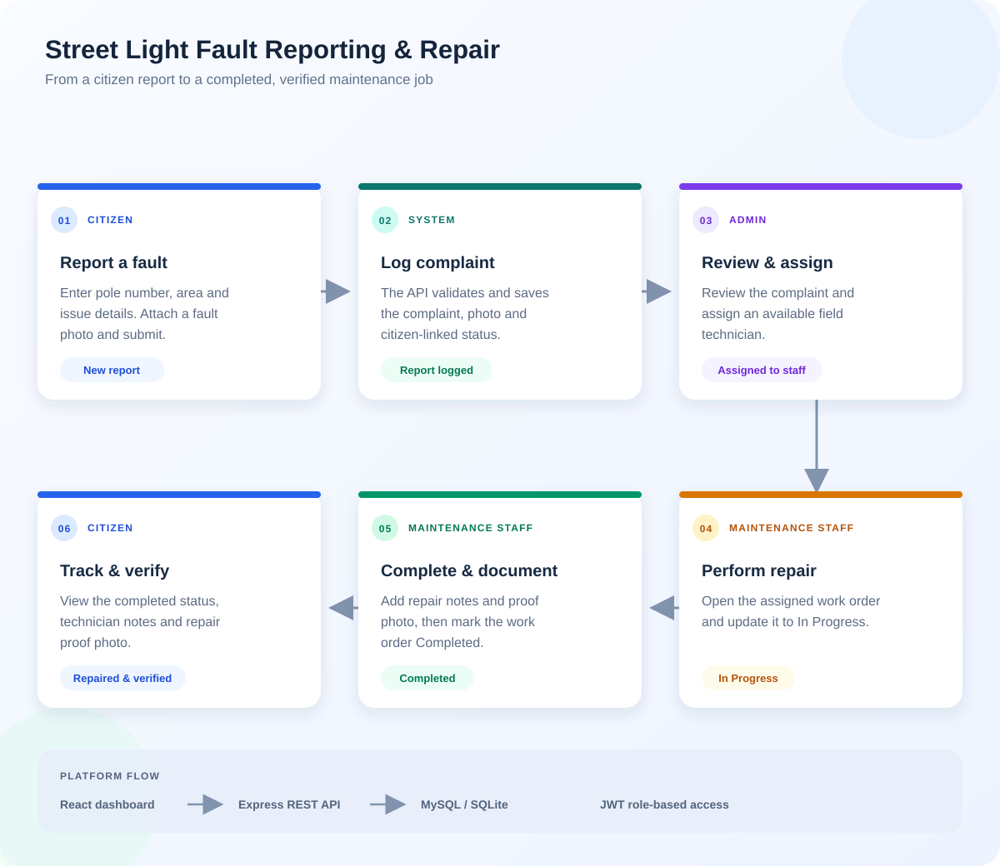
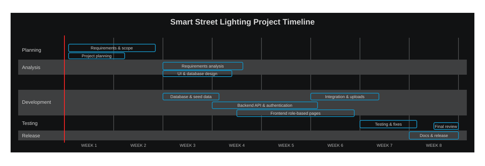

# Smart LED Street Lighting Fault Reporting & Maintenance Scheduling Dashboard

A complete full-stack web application built using **React.js**, **Node.js (Express.js)**, and **MySQL** (with automated SQLite fallback for out-of-the-box testing) for reporting faulty street lights and scheduling maintenance repairs across municipal zones.

---

## 🚀 Key Features by User Role

### 1. Citizen Role
- **Account Registration & Authentication**: Secure sign up & login.
- **Report Street Light Fault**: Form to enter Pole Number, select Locality/Area, describe the issue, and attach a fault image.
- **Track Complaint Status**: Interactive 3-step visual progress tracker (`Report Logged` → `Assigned to Staff` → `Repaired & Verified`).
- **View Repair Proof**: Inspect repair notes and completion proof photos uploaded by maintenance personnel.

### 2. Admin Role
- **Executive KPI Dashboard**: Overview of Total Complaints, Pending Complaints, In Progress Complaints, Completed Repairs, Active Technicians, and Monitored Street Poles.
- **Fault Matrix & Filter Table**: Filter complaints by status or area, and search by Pole Number or Citizen name.
- **Maintenance Staff Assignment**: Dropdown modal to assign open complaints to field technicians.
- **User & Staff Management**: Register new Maintenance Staff accounts and view all system user roles.

### 3. Maintenance Staff Role
- **Assigned Workbench**: View queue of assigned street light repairs.
- **Update Work Order Status**: Change status between `In Progress` and `Completed`.
- **Log Inspection Notes**: Detail fix actions (e.g., ballast replacement, wiring fix).
- **Upload Repair Proof Image**: Upload photo proving successful repair completion.

## Complaint-to-Repair Workflow



## Project Timeline

The Gantt chart below is an **illustrative 8-week schedule**. Week ranges are estimates and can be adjusted to match the actual project plan.



---

## 🛠️ Tech Stack & Dependencies

- **Frontend**: React.js (Vite), Tailwind CSS, Lucide React Icons, Axios, React Router DOM v6
- **Backend**: Node.js, Express.js, JWT Authentication (`jsonwebtoken`), Password Hashing (`bcryptjs`), File Uploads (`multer`), CORS
- **Database**: MySQL (`mysql2` driver) + SQLite (`sqlite3` fallback database engine)

## Abbreviations

- **API** — Application Programming Interface
- **CORS** — Cross-Origin Resource Sharing
- **DDL** — Data Definition Language
- **HTTP** — Hypertext Transfer Protocol
- **JWT** — JSON Web Token
- **KPI** — Key Performance Indicator
- **RBAC** — Role-Based Access Control
- **REST** — Representational State Transfer
- **SQL** — Structured Query Language
- **UI/UX** — User Interface / User Experience

---

## 📂 Project Folder Structure

```
P2/
├── backend/
│   ├── config/
│   │   └── db.js                 # MySQL Pool & SQLite Fallback engine
│   ├── controllers/
│   │   ├── authController.js     # User registration, JWT login, profile
│   │   ├── complaintController.js# Fault reporting, staff assignment, repair logging
│   │   ├── lightController.js    # Street light inventory & area lookup
│   │   └── userController.js     # Staff account creation & user directory
│   ├── middleware/
│   │   ├── auth.js               # JWT verification & role authorization
│   │   └── upload.js             # Multer upload handler for fault & repair photos
│   ├── routes/
│   │   ├── authRoutes.js
│   │   ├── complaintRoutes.js
│   │   ├── lightRoutes.js
│   │   └── userRoutes.js
│   ├── uploads/                  # Storage directory for uploaded images
│   ├── schema.sql                # Production MySQL DDL script
│   ├── seed.sql                  # Production MySQL sample seed data
│   ├── package.json
│   └── server.js                 # Express server entry point
├── frontend/
│   ├── public/
│   ├── src/
│   │   ├── api/
│   │   │   └── client.js         # Axios client with JWT interceptor
│   │   ├── components/
│   │   │   ├── Navbar.jsx        # Role-based header bar
│   │   │   ├── Sidebar.jsx       # Dynamic role sidebar navigation
│   │   │   ├── StatCard.jsx      # KPI dashboard card
│   │   │   └── StatusBadge.jsx   # Status indicator badge
│   │   ├── context/
│   │   │   └── AuthContext.jsx   # Auth provider state manager
│   │   ├── pages/
│   │   │   ├── Login.jsx         # Multi-role login with demo presets
│   │   │   ├── Register.jsx      # Citizen signup page
│   │   │   ├── citizen/
   │   │   │   ├── ReportFault.jsx  # Fault reporting form & photo upload
   │   │   │   └── MyComplaints.jsx # Live status tracking stepper
   │   │   ├── admin/
   │   │   │   ├── Dashboard.jsx    # Executive dashboard & metrics
   │   │   │   ├── AllComplaints.jsx# Filterable grid & assignment modal
   │   │   │   └── ManageUsers.jsx  # Staff creation & user directory
   │   │   └── staff/
   │   │       └── AssignedTasks.jsx# Work order status & repair notes/proof
   │   ├── App.jsx               # Protected router layout
   │   ├── index.css             # Tailwind glassmorphism styles
   │   └── main.jsx
   ├── package.json
   ├── tailwind.config.js
   └── vite.config.js
└── README.md
```

---

## 🗄️ Database Setup (MySQL)

### Option A: Standard MySQL Server
1. Import `backend/schema.sql` into your MySQL server:
   ```bash
   mysql -u root -p < backend/schema.sql
   mysql -u root -p < backend/seed.sql
   ```
2. Create a `.env` file inside `backend/.env`:
   ```env
   PORT=5000
   JWT_SECRET=smart_street_light_secret_key_2026
   DB_HOST=localhost
   DB_USER=root
   DB_PASSWORD=your_mysql_password
   DB_NAME=smart_light_db
   DB_PORT=3306
   ```

### Option B: Automatic SQLite Fallback (Zero Config)
If MySQL is not installed or offline, the backend automatically creates `backend/smart_light_db.sqlite` with pre-configured demo data upon start!

---

## ⚡ Running the Application

### 1. Start the Backend API
```bash
cd backend
npm start
```
*Backend runs on `http://localhost:5000/api`*

### 2. Start the Frontend Application
```bash
cd frontend
npm run dev
```
*Frontend runs on `http://localhost:5173`*

---

## 🔑 Demo Account Credentials

| Role | Email | Password | Allowed Access |
| :--- | :--- | :--- | :--- |
| **Admin** | `admin@smartlight.com` | `admin123` | Executive Dashboard, All Complaints Matrix, Staff Assignment, Manage Users |
| **Maintenance Staff** | `staff@smartlight.com` | `staff123` | Assigned Work Orders, Update Status (`In Progress`/`Completed`), Upload Repair Proof |
| **Citizen** | `citizen@smartlight.com` | `citizen123` | Report Faulty Light (Pole #, Area, Photo), Complaint History Stepper |

*(Note: The login page includes 1-click Quick Presets to populate these demo credentials automatically).*

---

## 🧪 Testing & Verification Walkthrough

1. **Log in as Citizen (`citizen@smartlight.com` / `citizen123`)**:
   - Go to **Report Faulty Light**. Select pole `SL-101` or enter custom pole ID.
   - Attach a fault photo and submit. Note status is `Pending`.
2. **Log in as Admin (`admin@smartlight.com` / `admin123`)**:
   - Check Executive Dashboard for updated KPI counts.
   - Go to **All Complaints Matrix**. Locate the new complaint and click **Assign Staff**. Select `John Repair Tech`.
3. **Log in as Maintenance Staff (`staff@smartlight.com` / `staff123`)**:
   - View assigned work order. Click **Update Repair Status**.
   - Change status to `Completed`, type repair notes, attach repair proof image, and submit.
4. **Log back in as Citizen**:
   - Verify the progress stepper now marks the complaint as `Repaired & Verified` with technician repair notes visible.
